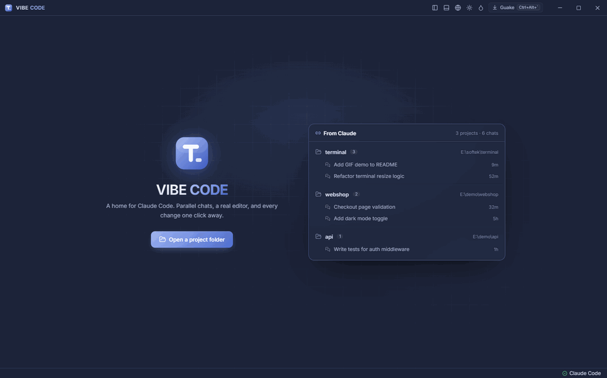

# VIBE CODE

Desktop workspace for **Claude Code**: several parallel chats, a Monaco editor (the VS Code editor core), a live Git *Changes* panel with diff view, and an integrated terminal.



Stack: Tauri 2 (Rust backend, system WebView2 / WKWebView) · React · TypeScript · Vite · Monaco · xterm.js (WebGL) · portable-pty (ConPTY)

## Run

```bash
npm install
npm run dev        # tauri dev: Vite with hot reload + the Rust backend
npm run build      # release build + installer in src-tauri/target/release/bundle/
```

Building needs Node 24+, Rust (stable, MSVC toolchain on Windows) and, on Windows, the
Visual Studio C++ Build Tools. Running needs Git and the `claude` CLI on PATH
(`npm install -g @anthropic-ai/claude-code`). The app itself has no Node runtime.

## Shortcuts

| Keys | Action |
|---|---|
| Alt+` (global) | Show / hide VIBE CODE (drop-down slides over any app) |
| Ctrl+Shift+N | New chat |
| Alt+1…9 | Switch chat |
| Ctrl+P | Go to file |
| Ctrl+Shift+E / G / C | Explorer / Changes / Chats |
| Ctrl+` | Toggle terminal |
| Ctrl+B | Toggle sidebar |
| Ctrl+S / Ctrl+W | Save / close editor tab |
| Shift+Enter (in chat) | Newline in Claude prompt |

## Drop-down (Guake) mode

Click **Guake** in the title bar (or use the tray icon menu). VIBE CODE then lives at the top edge of the screen under the mouse: the global hotkey slides it down over whatever app you're in and back up again. The tray menu sets height, opacity and "hide when focus is lost". Dragging the bottom edge changes the height. The hotkey is `hotkey` in `%APPDATA%\TINJS Studio\settings.json` (F12 can't be used: Windows reserves it for debuggers).

## Claude history

The Chats sidebar lists every project and conversation from `~/.claude/projects`, the store shared by the Claude desktop app, the CLI and the IDE extensions. It updates live. Clicking a conversation resumes it (`claude --resume <id>`) in its own folder. New chats are started with `--session-id`, so they show up in that same history.

## Layout

- `src-tauri/src` – Rust backend: terminals (`pty.rs`), files + watcher, git, Claude's session
  store, SQL Server (`mssql.rs`), Zalo (`zalo/`), the built-in browser (`browser.rs`, native
  WebView2 tabs that sleep when hidden), the MCP server Claude's tools talk to (`mcp.rs`), window /
  tray / drop-down mode (`windowing.rs`)
- `src/renderer/src/api.ts` – `window.api`: the page's bridge to the Rust commands and events
- `src/renderer/src` – UI (`components/`), state (`store.ts`, `actions.ts`), terminals, Monaco setup

`STUDIO_USER_DATA=<folder>` runs with a separate profile (settings, logins, Zalo session).
